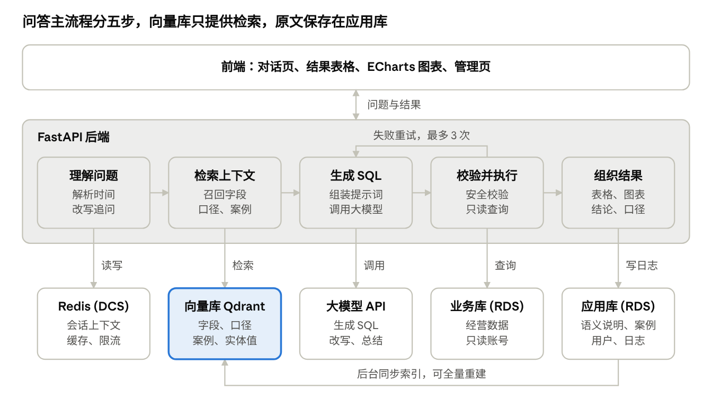

# DataAgent 功能清单

2026-11-05 · @FlymeTotheStar

## 定位与范围

第一版让不懂 SQL 的个体卖家用中文询问经营数据，并得到表格、图表、一句话结论和口径说明。

| 项目 | 第一版的边界 |
| --- | --- |
| 目标用户 | 小电商卖家、个体经营者 |
| 数据来源 | 一个固定的业务库，8～10 张表，几十万到百万行模拟数据 |
| 核心价值 | 不写 SQL 也能查数，并且能看到每个结论的口径和时间范围 |
| 差异化 | 除了查询数据，还能解释指标变化的原因 |
| 不做 | 连接任意用户数据库、修改业务数据、多店铺多租户、对接真实电商平台 |

## 系统组成

系统由前端、FastAPI 后端和五个外部依赖组成，向量库负责语义检索，不保存唯一的原始数据。

大模型还会在“理解问题”时改写追问，在“组织结果”时撰写结论。Redis 同时缓存已通过校验的查询结果。

## 功能清单

全部功能按优先级分三档：P0 缺了就无法完整演示，P1 主要用来拿分和练技术，P2 有时间再做。

### A. 智能问数

| 编号 | 功能 | 说明 | 优先级 |
| --- | --- | --- | --- |
| A1 | 自然语言提问 | 在对话页用中文提问，并显示检索、生成、执行等处理状态 | P0 |
| A2 | 时间解析 | 按固定的 as_of_date，把“上个月”“近 7 天”转成具体日期 | P0 |
| A3 | 上下文检索 | 从向量库召回相关字段、指标口径和历史案例 | P0 |
| A4 | SQL 生成 | 根据问题和检索到的上下文，让大模型生成 SQL | P0 |
| A5 | 自动修正 | 执行报错或结果为空时把信息反馈给模型，最多重试 3 次 | P0 |
| A6 | 多轮追问 | 把“那上上个月呢”改写成完整问题后再处理 | P1 |
| A7 | 实体值匹配 | 把用户说的商品、类目、渠道名称对应到库里的真实值 | P1 |
| A8 | 澄清与拒答 | 问题有歧义时反问；数据不存在或涉及敏感信息时拒答 | P1 |

### B. 结果展示

| 编号 | 功能 | 说明 | 优先级 |
| --- | --- | --- | --- |
| B1 | 结果表格 | 支持分页和排序；结果被 LIMIT 截断时明确提示 | P0 |
| B2 | 图表推荐 | 根据结果形状选择折线、柱状或饼图，用 ECharts 渲染 | P0 |
| B3 | 一句话结论 | 只依据查询结果总结，不允许出现结果里没有的数字 | P0 |
| B4 | 口径说明 | 展示用到的指标定义、时间范围和数据表 | P0 |
| B5 | 查看 SQL | 默认折叠，需要时展开 | P1 |
| B6 | 结果导出 | 下载 CSV | P2 |

### C. 经营分析

| 编号 | 功能 | 说明 | 优先级 |
| --- | --- | --- | --- |
| C1 | 异动归因 | 回答“退货率为什么涨了”：按商品、渠道、物流下钻，找出影响最大的因素 | P1 |
| C2 | 每日经营简报 | 定时生成核心指标和异常提醒，作为异步任务运行 | P2 |

### D. 查询安全

| 编号 | 功能 | 说明 | 优先级 |
| --- | --- | --- | --- |
| D1 | SQL 校验 | 用 sqlglot 解析，只放行单条 SELECT，拦截危险函数、`INTO OUTFILE` 和系统库 | P0 |
| D2 | 只读账号 | Agent 只用专用账号连接业务库，没有写权限 | P0 |
| D3 | 敏感字段保护 | 用列权限或脱敏视图挡住手机号、地址等字段 | P0 |
| D4 | 自动补 LIMIT | 没有 LIMIT 时自动补上，超过上限时改为上限值 | P0 |
| D5 | 查询超时 | 在数据库层限制执行时间 | P0 |
| D6 | 提示注入防护 | 将用户输入和系统指令分开，并用攻击样例测试 | P1 |

### E. 语义层与知识库

| 编号 | 功能 | 说明 | 优先级 |
| --- | --- | --- | --- |
| E1 | 语义说明维护 | 在管理页编辑表和字段的业务含义、同义词、JOIN 规则 | P0 |
| E2 | 指标口径维护 | 定义 GMV、退货率、ROI 等指标的计算规则 | P0 |
| E3 | 答案反馈 | 用户标记“正确”或“错误”，正确的问答进入待审核列表 | P0 |
| E4 | 案例审核 | 审核通过后才能被检索使用，并支持修改或下线 | P1 |
| E5 | 向量索引同步 | 内容变更后增量更新，并支持一键全量重建 | P0 |
| E6 | 检索调试 | 输入问题后查看召回内容和相似度分数 | P1 |

### F. Redis 能力

| 编号 | 功能 | 说明 | 优先级 |
| --- | --- | --- | --- |
| F1 | 查询结果缓存 | 键使用规范化 SQL 的哈希和数据版本，并设置 TTL | P0 |
| F2 | 会话上下文 | 保存最近几轮的问题、SQL 和结果摘要，支持 A6 | P1 |
| F3 | 接口限流 | 用 Lua 实现滑动窗口，控制每个用户的大模型调用次数 | P1 |
| F4 | 热门问题排行 | 用有序集合按天统计，并合并出近 7 天排行 | P1 |
| F5 | 元数据缓存 | 缓存表结构，在 schema 版本变化时失效 | P1 |
| F6 | 缓存击穿保护 | 相同查询并发到达时，只让一个请求执行 | P1 |
| F7 | 故障降级 | Redis 不可用时跳过缓存，问答主流程继续运行 | P1 |
| F8 | 异步任务状态 | 记录长查询或简报任务的排队、运行、完成状态 | P2 |
| F9 | Embedding 缓存 | 相同文本不重复调用向量接口 | P2 |

### G. 用户与运行记录

| 编号 | 功能 | 说明 | 优先级 |
| --- | --- | --- | --- |
| G1 | 查询日志 | 记录问题、SQL、耗时、重试次数、模型用量和结果状态 | P0 |
| G2 | 用户登录 | 区分普通用户和管理员，管理页仅管理员可见 | P1 |
| G3 | 会话历史 | 查看和继续历史对话 | P1 |
| G4 | 运行看板 | 展示缓存命中率、失败率、模型调用量和热门问题 | P2 |

### H. 数据与性能

| 编号 | 功能 | 说明 | 优先级 |
| --- | --- | --- | --- |
| H1 | 业务库设计 | 商品、订单、订单明细、客户、退款、物流、广告投放等 8～10 张表 | P0 |
| H2 | 应用库设计 | 用户、会话、案例、语义说明、日志，与业务库分开 | P0 |
| H3 | 模拟数据生成 | 固定随机种子，并埋入季节性、大促、高退货商品、低 ROI 渠道 | P0 |
| H4 | 索引优化报告 | 用 EXPLAIN 对比代表性查询加索引前后的执行计划和耗时 | P0 |

### I. 评测

| 编号 | 功能 | 说明 | 优先级 |
| --- | --- | --- | --- |
| I1 | 评测集 | 30～50 题，覆盖单表、多表、口径、追问、拒答，并与案例库隔离 | P0 |
| I2 | 自动评测脚本 | 比较执行结果，按题型统计准确率 | P0 |
| I3 | 安全测试集 | 用恶意 SQL 和提示注入样例验证拦截效果 | P1 |
| I4 | 检索评测 | 统计 Recall@5，并对比全量 schema 与检索方案 | P1 |
| I5 | 准确率记录 | 记录每次改提示词或检索策略后的结果 | P1 |

### J. 部署与交付

| 编号 | 功能 | 说明 | 优先级 |
| --- | --- | --- | --- |
| J1 | 本地一键启动 | 用 Docker Compose 启动应用、数据库、Redis 和向量库 | P0 |
| J2 | 华为云部署 | 使用 RDS、DCS、云服务器和大模型 API | P0 |
| J3 | 码道使用证明 | 按周保存对话记录、提交记录和关键截图 | P0 |
| J4 | 提交包 | 包含 ppt、project、video、codearts_proof、readme，且不带密钥 | P0 |
| J5 | 大模型适配层 | 统一封装模型调用，便于更换模型 | P0 |
| J6 | 演示模式 | 没有 API key 时，用预置问答跑通页面 | P1 |

## 向量数据库方案

向量库首选 Qdrant：只需一个容器就能运行，支持按字段过滤，适合一人项目部署。代码通过 VectorStore 接口访问，以后可以换成 Milvus。

| 集合 | 存什么 | 作用 | 主要过滤条件 |
| --- | --- | --- | --- |
| schema_items | 字段说明、同义词、JOIN 规则 | 找到相关字段 | schema 版本 |
| metrics | 指标名称、别名和口径 | 确定计算规则 | 是否启用 |
| qa_cases | 审核通过的问题和 SQL | 作为生成示例 | 审核状态 |
| entity_values | 商品名、类目、渠道、地区 | 匹配用户说的名称 | 实体类型 |

实现时遵守五条规则：

- **数据来源：** 应用库保存原文，向量库只保存索引，丢失后可以重建。
- **同步：** 内容变更先写入待同步记录，再由后台任务更新向量，失败后可以重试。
- **表结构上下文：** 所有表的一句话摘要始终提供给模型，字段细节按检索结果提供，避免漏掉整张表。
- **实体匹配：** 先做精确匹配，匹配不到再做向量检索；低于相似度阈值时不使用，并触发反问。
- **故障降级：** 向量库不可用时，退回应用库的关键词匹配，并在日志中标记。

更换 embedding 模型后，必须全量重建索引，因此每条向量都要记录模型名称。

## 验收标准

以下数值是初定目标，跑出基线后再调整；安全两项不放宽。

| 验收项 | 标准 | 验证方式 |
| --- | --- | --- |
| 问答准确率 | 执行结果准确率不低于 80% | 运行 I2 |
| 检索效果 | Recall@5 不低于 90% | 运行 I4 |
| 危险 SQL | 测试样例 100% 拦截 | 运行 I3 |
| 敏感字段 | 测试中泄露数为 0 | 运行 I3 |
| 响应时间 | 缓存命中小于 200 ms，首次问答 P95 小于 15 秒 | 查询日志统计 |
| 索引优化 | 至少 5 条查询有前后对比 | H4 报告 |
| 实际可用性 | 关闭 Redis 或向量库后，仍能完成问答 | 手动故障演练 |
| 交付 | 在全新环境按 README 启动成功 | 按文档从零执行 |

## 待确认事项

前四项会影响开工方案，建议在第一周内确认。

- [ ] 码道使用痕迹的具体要求，是否允许其他 AI 工具辅助
- [ ] 华为云可用的大模型、调用额度和 embedding 接口
- [ ] 评委如何运行项目：本地启动，还是访问线上地址
- [ ] 比赛截止日期和每周可投入时间
- [ ] 业务库引擎：建议 RDS for MySQL 8
- [ ] Qdrant 在云服务器上的部署方式和费用
- [ ] DCS 是否支持限流所需的 Lua 脚本
