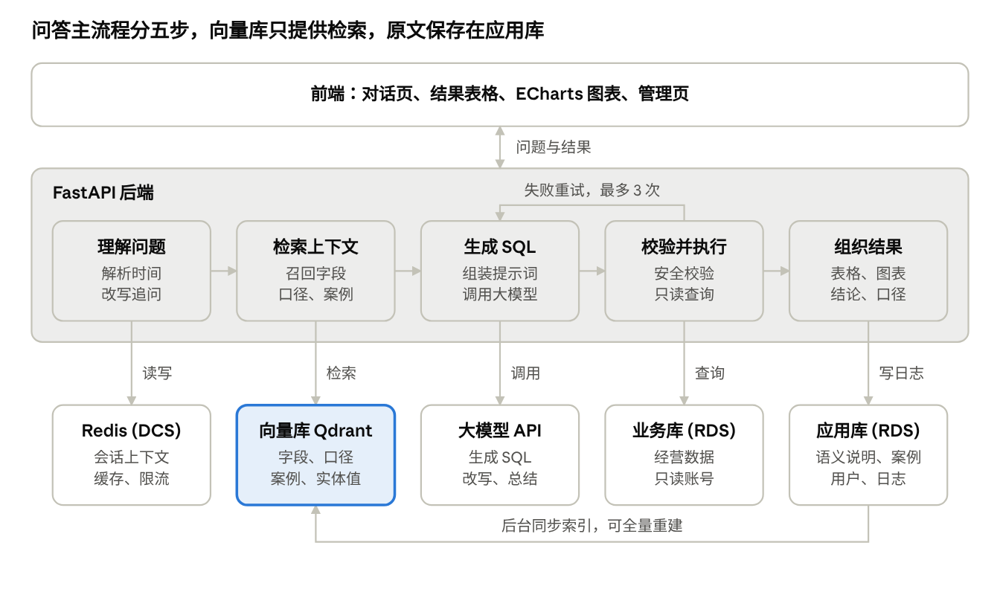

# 【一人公司经营数据助手 DataAgent】

提报课题战队：（待填写）

## 一、作品的详细介绍

### 1. 作品概述

DataAgent 是面向小电商卖家和个体经营者的经营数据助手。用户用中文提问，例如“上个月哪个商品退货率最高”，系统自动生成并执行 SQL，返回表格、图表、一句话结论和口径说明。

一人公司通常没有专职数据分析师，经营者往往也不会写 SQL。本作品希望把查数、看图和初步分析合并到一次对话中，让经营者能快速得到可核对的答案。

第一版连接一个固定的业务数据库，包含商品、订单、订单明细、客户、退款、物流、广告投放等 8～10 张表，并使用几十万到百万行模拟数据进行演示和测试。

### 2. 作品的功能

| 功能模块 | 主要功能 |
| --- | --- |
| 智能问数 | 自然语言提问、时间解析、上下文检索、SQL 生成、自动修正、多轮追问、实体值匹配、澄清与拒答 |
| 结果展示 | 结果表格、图表推荐与渲染、一句话结论、口径说明、查看 SQL |
| 经营分析 | 指标异动归因，例如按商品、渠道、物流分析退货率上升的原因 |
| 查询安全 | SQL 校验、只读账号、敏感字段保护、自动补 LIMIT、查询超时、提示注入防护 |
| 语义层与知识库 | 维护表和字段含义、指标口径、JOIN 规则；收集用户反馈并审核历史案例 |
| 性能与成本控制 | 查询结果缓存、接口限流、元数据缓存、缓存击穿保护、故障降级 |
| 运行与评测 | 查询日志、热门问题排行、准确率评测、检索评测、安全测试 |

### 3. 技术实现方案

#### 3.1 总体架构

系统由前端、FastAPI 后端和五个外部依赖组成。前端负责对话、结果展示和后台管理；后端负责完成问答主流程。

| 层次 | 技术选型 |
| --- | --- |
| 前端 | 对话页、结果表格、ECharts 图表、管理页 |
| 后端 | Python、FastAPI、SQLAlchemy、sqlglot |
| 业务库与应用库 | 华为云 RDS，计划使用 MySQL 8，业务数据与应用数据分开存放 |
| 缓存 | 华为云 DCS（Redis） |
| 向量检索 | Qdrant，部署在云服务器上 |
| 大模型 | 华为云大模型 API，通过统一适配层调用 |
| 开发工具 | 华为云码道（CodeArts），作为核心 AI 编程工具 |

#### 3.2 问答流程

1. **理解问题：** 解析时间范围，并把追问改写成完整问题。
2. **检索上下文：** 从向量库召回相关字段、指标口径、历史案例和实体值。
3. **生成 SQL：** 组装提示词，调用大模型生成 SQL。
4. **校验并执行：** 通过安全校验后，使用只读账号执行查询。执行报错或结果为空时，把信息反馈给模型，最多重试 3 次。
5. **组织结果：** 返回表格、推荐图表、一句话结论和口径说明。

用户标记为“正确”的问答进入待审核列表，审核通过后写入案例库，供后续检索使用。

#### 3.3 语义层与向量检索

语义层保存表和字段的业务含义、同义词、JOIN 规则和指标口径。应用库保存原文，Qdrant 保存检索索引，索引丢失后可以重建。

向量库分为四个集合：

| 集合 | 内容 | 用途 |
| --- | --- | --- |
| schema_items | 字段说明、同义词、JOIN 规则 | 找到相关字段 |
| metrics | 指标名称、别名和口径 | 确定计算规则 |
| qa_cases | 审核通过的问题和 SQL | 提供生成示例 |
| entity_values | 商品名、类目、渠道、地区 | 匹配用户提到的名称 |

所有表的一句话摘要始终提供给模型，字段细节按检索结果提供，以降低漏掉整张表的风险。向量库不可用时，系统退回关键词匹配。

#### 3.4 数据库与安全设计

系统采用多层防护，不依赖模型自觉遵守规则：

- **SQL 校验：** 使用 sqlglot 解析 SQL，只放行单条 SELECT，并拦截危险函数和系统库。
- **数据库权限：** Agent 使用只读账号，并通过列权限或脱敏视图保护手机号、地址等敏感字段。
- **资源限制：** 自动补 LIMIT，并在数据库层设置查询超时。
- **性能优化：** 针对代表性查询设计索引，并用 EXPLAIN 对比优化前后的执行计划和耗时。

#### 3.5 Redis 设计

| 用途 | 实现方式 |
| --- | --- |
| 查询结果缓存 | 键由规范化 SQL 的哈希和数据版本组成，并设置 TTL |
| 多轮对话上下文 | 保存最近几轮的问题、SQL 和结果摘要 |
| 接口限流 | 使用 Lua 实现滑动窗口，控制大模型调用次数 |
| 热门问题排行 | 使用有序集合按天统计，并合并出近 7 天排行 |
| 元数据缓存 | 缓存表结构，在 schema 版本变化时失效 |
| 缓存击穿保护 | 相同查询并发到达时，只让一个请求执行 |

Redis 不可用时，系统跳过缓存，问答主流程继续运行。

#### 3.6 评测方案

项目将建立 30～50 题的评测集，覆盖单表、多表、指标口径、追问和拒答场景。脚本通过比较 SQL 的执行结果判断答案是否正确，并按题型统计准确率。

评测题与案例库保持隔离，避免准确率虚高。每次修改提示词或检索策略后都重新评测，并记录变化。

## 二、作品计划达到的技术创新性

1. **面向经营场景的多路语义检索。** 系统不只检索表结构，还分别检索字段说明、指标口径、历史案例和实体值，用来解决业务口语与数据库字段不一致的问题。

2. **答案可核对。** 每个结果都展示指标定义、时间范围和所用数据表。一句话结论只依据查询结果生成，不允许出现结果中没有的数字。

3. **从查询数据走向解释原因。** 针对“退货率为什么涨了”这类问题，系统按商品、渠道、物流等维度下钻，定位影响最大的因素，帮助经营者决定下一步检查什么。

4. **语法校验与数据库权限结合的安全设计。** sqlglot 负责快速拦截不合规 SQL，只读账号、列权限和脱敏视图提供最终保护。即使模型受到提示注入影响，也不能修改业务数据或读取受保护字段。

5. **经过审核的知识积累。** 用户反馈先进入待审核列表，审核通过后才能参与检索，避免错误案例污染后续回答。

6. **由评测驱动的优化。** 系统同时评测 SQL 执行结果、向量检索效果和安全拦截效果，并对比全量 schema 与检索方案，用数据判断优化是否有效。

7. **具备降级能力的工程设计。** 查询结果缓存基于规范化 SQL 和数据版本，避免把相对时间问题的旧结果返回给用户。Redis 或向量库不可用时，系统仍能继续完成问答。

## 三、作品的实用性说明

### 1. 解决的实际问题

个体经营者日常需要关注销售额、退货率、广告投入产出和物流时效，但这些数据通常分散在不同表和报表中。自行分析需要导出、整理和计算，而聘请专职分析师的成本又较高。

DataAgent 让用户直接用业务语言提问，把一次数据查询的门槛从“会写 SQL”降低为“能说清问题”。

### 2. 典型使用场景

| 场景 | 用户提问 | 系统提供的帮助 |
| --- | --- | --- |
| 商品经营 | 上个月哪个商品退货率最高？ | 查询商品排行，并说明退货率口径 |
| 销售复盘 | 最近 30 天 GMV 的变化趋势如何？ | 生成趋势图和一句话结论 |
| 广告优化 | 哪个投放渠道的 ROI 最低？ | 对比各渠道投入和产出 |
| 物流检查 | 哪个地区的发货时效最慢？ | 按地区汇总物流时效 |
| 异常分析 | 退货率为什么涨了？ | 下钻分析，定位影响最大的商品或渠道 |
| 连续追问 | 那上上个月呢？ | 沿用上文条件，改写后重新查询 |

### 3. 使用门槛与落地性

- **易用：** 用户只需在对话页输入问题，不需要理解数据库结构。
- **可信：** 用户可以查看口径、时间范围和数据表，需要时还能展开 SQL。
- **安全：** Agent 只有只读权限，不能修改业务数据，敏感字段也会受到保护。
- **成本可控：** 缓存减少重复查询，限流控制大模型调用次数。
- **可维护：** 管理页可以维护语义说明、指标口径和案例，无需改代码。
- **易部署：** 本地可用 Docker Compose 启动，云上使用 RDS、DCS、云服务器和大模型 API 部署。

### 4. 计划验收目标

以下为初定目标，将根据基线评测结果调整；安全目标不放宽。

| 验收项 | 目标 |
| --- | --- |
| 问答准确率 | 执行结果准确率不低于 80% |
| 检索效果 | Recall@5 不低于 90% |
| 查询安全 | 危险 SQL 测试样例 100% 拦截，敏感字段泄露数为 0 |
| 响应时间 | 缓存命中小于 200 ms，首次问答 P95 小于 15 秒 |
| 可用性 | 关闭 Redis 或向量库后，仍能完成问答 |

### 5. 当前边界与后续扩展

第一版使用模拟数据，只连接一个固定业务库，不修改业务数据，也不支持多店铺多租户。验证效果后，可以继续扩展到每日经营简报、更多数据源和真实电商平台接入。
